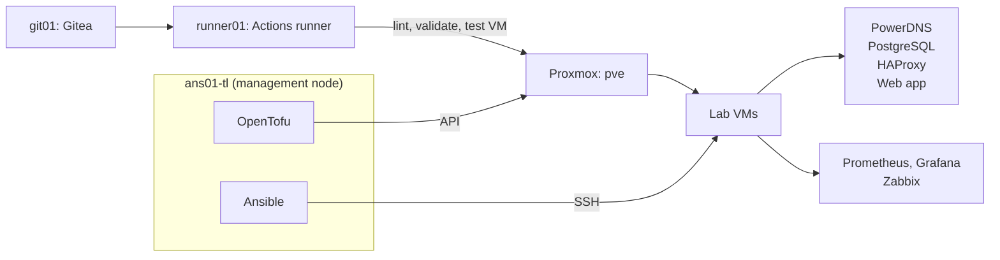

# proxmox-iac-lab

[Nederlands](README.nl.md) · English

A home lab where a small business environment is built and torn down entirely as code: virtual machines with OpenTofu, configuration with Ansible, checks through a CI pipeline. The lab is a personal learning environment, not production.

Who it is for: readers who want to see how I set up, test and document Linux infrastructure reproducibly.

Status: first version. See [Planned](#planned).

## What has been built

| Layer | Tooling | What it does |
|---|---|---|
| Virtualisation | Proxmox VE (node `pve`) | Hypervisor for all lab VMs |
| Network | OPNsense (`fw01-tl`) | Firewall and routing for the lab subnet |
| Provisioning | OpenTofu, `bpg/proxmox` provider | Clones VMs from templates |
| Configuration | Ansible (12 roles) | Configures services, idempotent |
| CI | Gitea + Actions runner | Lint, `tofu fmt`/`validate`, temporary test VM per run |
| Services | PowerDNS, PostgreSQL, HAProxy, Prometheus, Grafana, Zabbix | The environment being built |

The lab runs on the private subnet `10.20.10.0/24` with the domain `lab.local`.

## Architecture



OpenTofu decides which VMs exist. Ansible decides what runs on them. Git is the source of truth.

## VMs and what is in code

| VM | In OpenTofu | Role |
|---|---|---|
| pdns01, pdns02 | yes | DNS (PowerDNS) |
| app01, app02 | yes | Example web app |
| db01 | yes | PostgreSQL |
| git01 | yes | Gitea |
| proxy01 | yes | HAProxy |
| mon-lab01, mon-lab02 | yes | Prometheus/Grafana and Zabbix |
| runner01 | yes | Actions runner |
| ans01-tl | no | management node, built by hand |
| fw01-tl | no | OPNsense, configured by hand |
| ai01-tl | no | AI VM with GPU passthrough, not in code yet |
| Templates 9000, 9100, 9200 | no | built by hand, not in code |

That makes **10 VMs in code**. A full destroy and rebuild has been verified for 8 of them; the two PowerDNS VMs were added later and were not part of that test. The build time has not been measured yet, so it is not stated here.

## Repository layout

```
roles/            12 Ansible roles
playbooks/        one playbook per service
inventories/      homelab and production (without vault files)
opentofu/         the lab's VMs
test_opentofu/    temporary VMs for the pipeline (VMID 240-254)
.gitea/workflows/ CI: lint and test VM
docs/             Root-cause analysis (English)
```

## Root-cause analysis

Incidents from building the lab, each in the same format: symptom, root cause, fix, lesson.

[Read the analysis](docs/rca.en.md)

## Secrets and placeholders

Secrets are kept in Ansible Vault and are not published. `inventories/homelab/vault.yml.example` shows which variables are needed. Real values go in `vault.yml`, which is listed in `.gitignore`.

| Placeholder | Meaning |
|---|---|
| `<WAARDE>` | value from your own Ansible Vault (Dutch for "value") |
| `<TOKENNAAM>`, `<SECRET>` | Proxmox API token (`terraform.tfvars.example`) |
| `<DB-HOST>` | address of the PostgreSQL server |
| `<GIT-HOST>` | address of the Gitea server |
| `<ZABBIX-SERVER-IP>` | address of the Zabbix server |

## Deliberate lab choices

- `curl -k` in the CI workflow: the test certificate of the Proxmox API is self-signed. In production: a valid certificate or `--cacert`.
- `sslmode=disable` for the PostgreSQL connection of the OpenTofu state: only inside the lab subnet. In production: TLS on.
- The PostgreSQL backend for the OpenTofu state is commented out in `opentofu/main.tf`. The state is currently local.

## Known limitations

- The `postgresql` and `zabbix_server` roles never report `changed` when creating database users, even on a real change (`changed_when` is missing). This still needs fixing.
- CI only runs checks (lint, `fmt`, `validate`). There is no `tofu plan` in the pipeline and no automatic `apply`.
- The workflow looks for the test VM's IP address in `10.20.10.0/24`; outside this lab it must be adapted.
- Code comments are partly Dutch. They will be translated.

## Planned

- A k3s cluster on the lab VMs. Not built yet.
